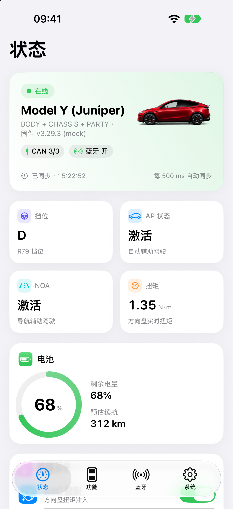
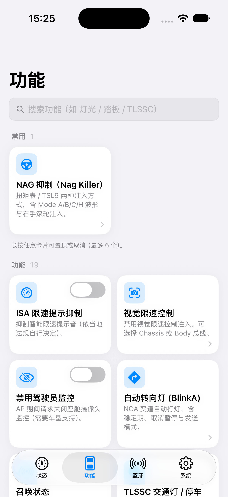
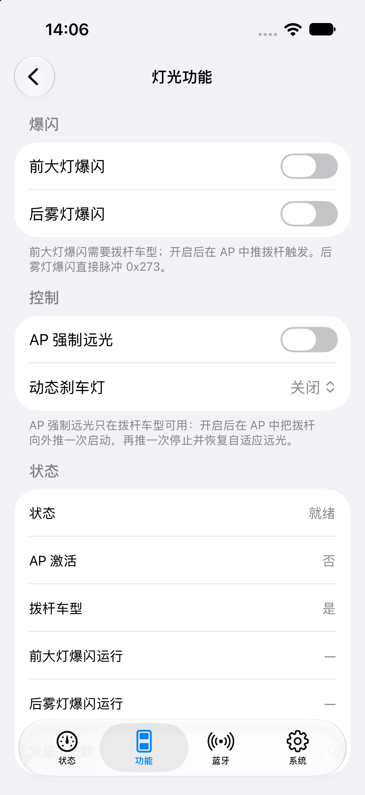

# P4管家 · P4CAN Companion

[简体中文](#简体中文) | [English](#english)

原生 iOS / iPadOS / macOS 控制台，用于 **P4-CAN Universal（ESP32-P4 三路 CAN 控制器）**。
SwiftUI + UIKit，不是网页套壳；所有状态直接来自设备 HTTP API，写入后回读校验。


-green)


**下载 / Download：** [Releases](https://github.com/Kaiser-DMr/p4can-companion/releases) · ad-hoc IPA，需要自签（AltStore / Sideloadly）。

> 本项目与 Tesla, Inc. 无关联。CAN 注入有风险，请只在驻车或封闭场地使用，并遵守当地法律。





---

## 简体中文

### 功能

底部四个标签：**状态 / 功能 / 蓝牙 / 系统**。

| 模块 | 内容 |
|---|---|
| **状态** | 设备在线、固件版本、内存、三路 CAN（BODY / CHASSIS / PARTY）收发与 Bus-Off、扭矩趋势、电池信息（固件提供时）、锁屏/灵动岛实时活动 |
| **功能** | 按固件新版结构分组：**灯光**（前大灯爆闪 / 后雾灯爆闪）→ **功能**（NAG、ISA、DMS、限速、BlinkA、召唤、TLSSC、ALC、踏板、AP 加速/回收、灯光功能、电池预热）→ **实验**（R79、FSD、SmartShift、地区、Lane Change、常驻 AP、Developer Test、召唤版本）→ **实验室功能**（R79 AP、召唤心跳、车窗、研究捕获、DMS 捕获、Mode H、R79 时序）。支持搜索、长按置顶 |
| **蓝牙** | S3XY 按键扫描/配对/连接、单击/双击/长按动作绑定、自动重连、日志导出 |
| **系统** | 车型卡片与更改车型、语言（设备网页 EN/简中/繁中）、无线、外观、刷新间隔、CAN GPIO、诊断/恢复、OTA 升级（SHA-256 校验）、重启、两级重置、恢复出厂、Service Mode、诊断导出 |

新功能页面按固件能力自动显示，不会在旧固件上留下死入口：

- **灯光功能**：AP 强制远光、动态刹车灯（关/轻踩/重踩）、官方远光/后雾爆闪开关与运行状态
- **Developer Test**：CHASSIS 0x3FD 六路 UI 信号覆盖 + 原厂读值
- **召唤版本标识**：0x259 `APP_summonVersionIdentifier`，P 档/召唤门控
- **语言**：写 `/api/dashboard/language`，只改设备网页语言，不改 App
- **Service Mode**：进入维护模式、中国市场恢复帧、TLSSC 0x331 强制注入与间隔（10–60000 ms）
- **NAG 高级参数**：新增「变道时暂停」

### 固件兼容

| 固件 | 支持情况 |
|---|---|
| 官方 v3.29.3 | 基础功能；无爆闪接口时自动隐藏爆闪入口 |
| 自编 v3.29.3 + 爆闪（fix5） | 独立的前/后爆闪页 |
| 自编 v3.35.3-strobe1-zh | 3.35.3 全部功能 + 独立爆闪页 + 中文 Dashboard |
| 自编 v3.35.3-eapnr1-zh | 上一行 + EAP/TLSSC 免重启补发（参考 P4can-No-Reboot） |
| 官方 v3.35.6 | 灯光页内远光/后雾爆闪、Developer Test、语言、Service 强制注入、召唤版本 |
| 官方 v3.35.8 | 语言（EN / 简中 / 繁中）、灯光爆闪与动态刹车灯、R79 驻车/召唤暂停；已移除的六路覆盖、召唤版本、强制注入自动隐藏 |

所有页面通过 `supportKey` 或端点探测（404 即隐藏）适配，不写死车型；Model 3 / Y / YL 通用。

### GPIO

固件默认（标准接线）：

| 总线 | TX | RX |
|---|---|---|
| CAN 1 BODY | 20 | 21 |
| CAN 2 CHASSIS | 22 | 23 |
| CAN 3 PARTY | 26 | 27 |

X179 线束：

| 总线 | TX | RX |
|---|---|---|
| BODY | 4 | 5 |
| CHASSIS | 2 | 3 |
| PARTY | 26 | 27 |

如果线束是反接版本，交换 BODY/CHASSIS：`BODY 2/3、CHASSIS 4/5`。
GPIO 存在独立 NVS（`p4gpio`），**跨 OTA 保留**；刷完新固件先确认三路 RX 再动车。

### 构建 App

要求：Xcode 16+、iOS 17+ / macOS 14+（Mac Catalyst）。

```bash
git clone https://github.com/Kaiser-DMr/p4can-companion.git
cd p4can-companion
open P4CANCompanion.xcodeproj
```

- Scheme：`P4CANCompanion`
- 无 SPM / CocoaPods 依赖；SnapKit 已内置
- 真机安装需要在 Signing & Capabilities 选择自己的 Team
- Release 构建可导出 ad-hoc IPA，用 AltStore / Sideloadly 自签安装

### 构建固件

固件源码在 `build/firmware-build/`：

- `P4-CAN-Universal-v3.35.3/`：英文 + 爆闪
- `P4-CAN-Universal-v3.35.3-zh/`：中文 Dashboard + 爆闪
- `3.35.3-爆闪移植.md`：移植点、产物哈希、GPIO 说明

```bash
cd build/firmware-build/P4-CAN-Universal-v3.35.3-zh
arduino-cli compile \
  --fqbn "esp32:esp32:esp32p4:ChipVariant=postv3,FlashSize=32M,PartitionScheme=app3M_fat9M_16MB,PSRAM=enabled,USBMode=hwcdc,CDCOnBoot=cdc,FlashMode=qio" \
  --output-dir ../../out-3353-zh .
```

- P4 v1.x 用 `ChipVariant=prev3`
- 中文页面：替换 `dashboard_source.html` 后运行 `python3 tools/build_dashboard.py`
- 官方 v3.35.6 / v3.35.8 源码未公开，App 通过 `/api/lighting/*`、`/api/r79/ap-control/*` 等接口兼容官方包

### 安全

- 本项目会直接向车辆 CAN 总线注入报文，可能导致车辆报错、功能异常或损坏；风险自负
- 只在驻车或封闭道路测试；不要在公共道路使用爆闪、强制远光等功能
- 不绕过任何法律法规或车辆安全机制
- 无任何明示或暗示担保

### 许可

GNU GPL v3.0，见 [LICENSE](LICENSE)。固件部分基于
[P4can-universal-unlock](https://github.com/06066060606060/P4can-universal-unlock)（GPL-3.0）；
第三方组件见 [NOTICE.md](NOTICE.md)。

---

## English

Native iOS / iPadOS / macOS companion for the **P4-CAN Universal** (ESP32-P4 three-bus CAN controller).
Built with SwiftUI + UIKit — not a web wrapper. Every value comes from the device HTTP API, and writes are read back for confirmation.

> Not affiliated with Tesla, Inc. CAN injection is risky. Use only while parked or on a closed course, and follow local laws.

### Features

Four tabs: **Status / Features / Bluetooth / Settings**.

| Tab | Contents |
|---|---|
| **Status** | Device online state, firmware, memory, three CAN buses (BODY / CHASSIS / PARTY) with RX/TX and bus-off counters, torque trend, battery info when provided, Live Activity |
| **Features** | Grouped like the current firmware UI: **Lighting** (headlight / rear fog strobe) → **Features** (NAG, ISA, DMS, vision speed, BlinkA, Summon, TLSSC, ALC, pedal, AP accel/regen, Lighting Features, battery preheat) → **Experimental** (R79, FSD, SmartShift, country, lane change, continuous AP, Developer Test, Summon Version) → **Lab** (R79 AP, summon heartbeat, window, research capture, DMS capture, Mode H, R79 timing). Search and long-press pinning |
| **Bluetooth** | S3XY button scan/pair/connect, single/double/long-press action mapping, auto-reconnect, log export |
| **Settings** | Vehicle profile and change profile, language (dashboard EN/简体/繁體), wireless, appearance, refresh interval, CAN GPIO, diagnostics/recovery, OTA with SHA-256, reboot, resets, factory reset, Service Mode, diagnostics export |

New pages appear only when the firmware supports them:

- **Lighting Features**: AP forced high beam, dynamic brake light (off/light/hard), official high-beam and rear-fog strobe toggles with running state
- **Developer Test**: six CHASSIS 0x3FD UI overrides plus stock readback
- **Summon Version**: 0x259 `APP_summonVersionIdentifier`, gated to P/summon
- **Language**: writes `/api/dashboard/language`; changes the device dashboard only
- **Service Mode**: enter service mode, China restore frames, TLSSC 0x331 force injection with 10–60000 ms interval
- **NAG advanced**: new “pause during lane change” toggle

### Firmware compatibility

| Firmware | Support |
|---|---|
| Official v3.29.3 | Core features; strobe entries hidden when endpoints are absent |
| Custom v3.29.3 + strobe (fix5) | Dedicated headlight / rear fog strobe pages |
| Custom v3.35.3-strobe1-zh | All v3.35.3 features + strobe pages + Chinese dashboard |
| Custom v3.35.3-eapnr1-zh | Above + EAP/TLSSC no-reboot replay (from P4can-No-Reboot) |
| Official v3.35.6 | Lighting-page strobes, Developer Test, language, Service force injection, Summon Version |
| Official v3.35.8 | Language (EN / Simplified / Traditional), lighting strobes and dynamic brake lights, R79 park/summon pause; removed 0x3FD overrides, summon version and force injection are hidden automatically |

Pages are gated by `supportKey` or endpoint probes (404 hides the entry). No hard-coded vehicle model; Model 3 / Y / YL are supported through capability bits.

### GPIO

Firmware defaults (standard wiring):

| Bus | TX | RX |
|---|---|---|
| CAN 1 BODY | 20 | 21 |
| CAN 2 CHASSIS | 22 | 23 |
| CAN 3 PARTY | 26 | 27 |

X179 harness:

| Bus | TX | RX |
|---|---|---|
| BODY | 4 | 5 |
| CHASSIS | 2 | 3 |
| PARTY | 26 | 27 |

For the reversed X179 harness, swap BODY/CHASSIS: `BODY 2/3, CHASSIS 4/5`.
GPIO lives in a separate NVS namespace (`p4gpio`) and **survives OTA**. Verify all three buses after flashing before driving.

### Build the app

Requirements: Xcode 16+, iOS 17+ / macOS 14+ (Mac Catalyst).

```bash
git clone https://github.com/Kaiser-DMr/p4can-companion.git
cd p4can-companion
open P4CANCompanion.xcodeproj
```

- Scheme: `P4CANCompanion`
- No SPM / CocoaPods dependencies; SnapKit is vendored
- Select your own Team for on-device builds
- Export an ad-hoc IPA for AltStore / Sideloadly

### Build the firmware

Firmware sources live under `build/firmware-build/`:

- `P4-CAN-Universal-v3.35.3/`: English + strobe
- `P4-CAN-Universal-v3.35.3-zh/`: Chinese dashboard + strobe
- `3.35.3-爆闪移植.md`: patch points, artifact hashes, GPIO notes

```bash
cd build/firmware-build/P4-CAN-Universal-v3.35.3-zh
arduino-cli compile \
  --fqbn "esp32:esp32:esp32p4:ChipVariant=postv3,FlashSize=32M,PartitionScheme=app3M_fat9M_16MB,PSRAM=enabled,USBMode=hwcdc,CDCOnBoot=cdc,FlashMode=qio" \
  --output-dir ../../out-3353-zh .
```

- Use `ChipVariant=prev3` for P4 v1.x
- Chinese dashboard: replace `dashboard_source.html`, then run `python3 tools/build_dashboard.py`
- Official v3.35.6 / v3.35.8 sources are not public; the app targets `/api/lighting/*`, `/api/r79/ap-control/*` and related endpoints

### Safety

- This project injects CAN frames into the vehicle. It can cause faults, break features, or damage hardware. Use at your own risk.
- Test only while parked or on a closed course. Do not use strobe or forced-high-beam features on public roads.
- Do not use it to bypass laws or vehicle safety systems.
- No warranty of any kind.

### License

GNU GPL v3.0 — see [LICENSE](LICENSE). Firmware is based on
[P4can-universal-unlock](https://github.com/06066060606060/P4can-universal-unlock) (GPL-3.0).
Third-party notices are in [NOTICE.md](NOTICE.md).
